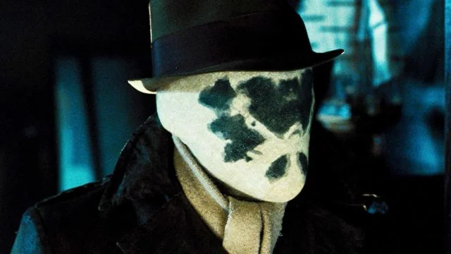
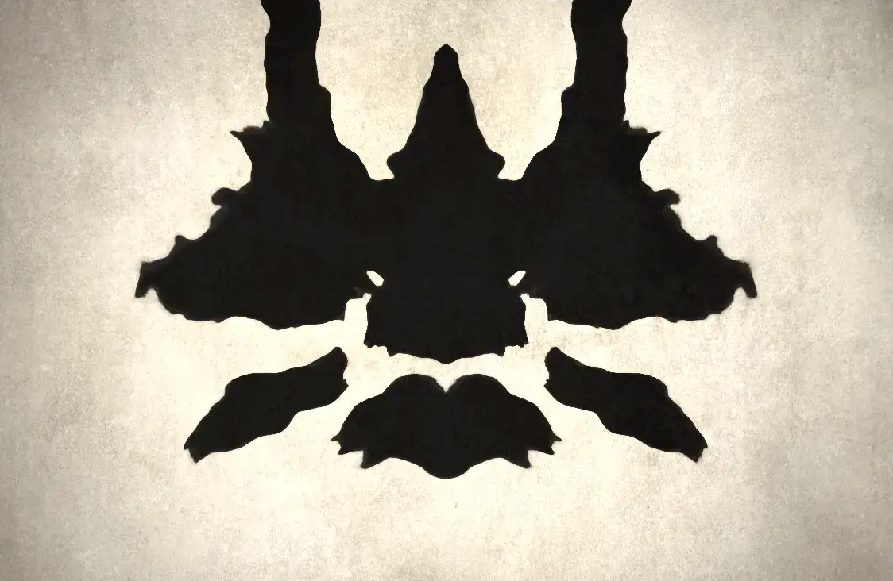

# Rorschach

A creative coding project to replicate the rorschach effect, inspired by the Watchmen film.



_Still from_ Watchmen _(2009). © 2009 Warner Bros. Entertainment Inc., Paramount Pictures Corporation and Legendary Pictures. All Rights Reserved. Watchmen and all related characters and elements are trademarks of and © DC Comics._



- Blog post: [Rorschach mask effect using p5js](https://dholmes.co.uk/blog/rorschach-mask-effect-using-p5js/)
- [Rorschach on p5js.org](https://editor.p5js.org/desholmes/full/KkA95pyNv).

## Tech stack

- [Node.js](https://nodejs.org/) v24.22.1
- [p5.js](https://p5js.org/) (WebGL, instance mode)
- [TypeScript](https://www.typescriptlang.org/)
- [Vite](https://vite.dev/)
- [Biome](https://biomejs.dev/)
- [Socket Firewall](https://github.com/SocketDev/sfw-free)

## How it works

The ink is drawn entirely in a fragment shader ([src/shaders/rorschach.frag](src/shaders/rorschach.frag)):

1. Canvas coordinates are mirrored around the vertical centre line (the "fold").
2. A domain-warped 3D simplex noise field, with time as the third axis, gives ink shapes that drift and morph continuously.
3. A soft elliptical envelope keeps the blots gathered around the centre.
4. Fine, smooth noise wobbles the ink edges. It isn't mirrored, so the two halves are never perfectly identical.
5. The ink builds from a slightly lighter wet rim to a saturated core. A faint, patchy shadow just outside each edge shows ink wicking into the fibres.
6. The ink is multiplied onto the fabric rather than painted over it. `public/textures/grunge.jpg` provides the stained, off-white fabric colour. `public/textures/concrete.jpg` provides fibre grain, which shows faintly through the ink.

A new random seed is picked on every page load. You can tune the drift speed, ink coverage, shape size, shape detail, edge softness and grain size at the top of [src/main.ts](src/main.ts).

### Textures

The texture images are not included in this repository because they are third-party stock images that aren't licensed for redistribution. Without them, the sketch generates simple stand-in textures, so it still runs.

To use your own, add two images:

| File                           | Role                                         | Good source material                                             |
| ------------------------------ | -------------------------------------------- | ---------------------------------------------------------------- |
| `public/textures/grunge.jpg`   | Base colour of the fabric                    | A light, stained or grungy paper or fabric photo                 |
| `public/textures/concrete.jpg` | Fine grain on the fabric and through the ink | A close-up of a fine-grained surface such as concrete or plaster |

Around 1536px on the longest side keeps the files small. On macOS you can resize a full-size original with the built-in `sips`. Keep the originals somewhere like `textures/`, which is gitignored:

```sh
sips -Z 1536 -s format jpeg -s formatOptions 55 textures/<your-stain-image>.jpg --out public/textures/grunge.jpg
sips -Z 1536 -s format jpeg -s formatOptions 50 textures/<your-grain-image>.jpg --out public/textures/concrete.jpg
```

## Commands

### Local development

1. `nvm use`: Select Node.js v24.22.1 via nvm
2. `npm run ci`: Installs dependencies
3. `npm start`: Starts the local DEV environment (Vite, http://localhost:5173)
4. `CTRL+c`: Stops local DEV environment

### Build

- `npm run build`: Type-checks and builds a static site into `dist/`
- `npm run preview`: Serves the built `dist/` locally
- `npm run build:editor`: Builds a version for the [p5.js web editor](https://editor.p5js.org) into `dist-editor/`

### Publishing to the p5.js web editor

The editor has no bundler, npm or TypeScript support. `npm run build:editor` turns the sketch into files the editor can run directly:

- `index.html`: loads p5 from jsDelivr, at the same version as `package-lock.json`
- `sketch.js`: plain, readable JavaScript with the shaders inlined
- `textures/grunge.jpg` and `textures/concrete.jpg`, if you've added them to `public/textures/` (see [Textures](#textures))

The editor has no import or upload API, so you add the files by hand:

1. Run `npm run build:editor`.
2. In the editor, sign in and create a new sketch.
3. Replace the contents of the editor's `index.html` and `sketch.js` with the files from `dist-editor/`. You can delete `style.css`, because the styles are inlined in `index.html`.
4. In the Sketch Files sidebar, use **+ → Create folder** to add a folder named `textures`. Then use **+ → Upload file** on that folder to upload both JPGs from `dist-editor/textures/`.
5. Press Play, then **Save**.

To update an existing editor sketch, rebuild and paste the new `sketch.js` over the old one. The textures only need uploading again if they change.

The editor finds uploaded files by matching quoted paths in `sketch.js`. Keep the texture paths in `src/main.ts` as complete string literals (for example `"textures/grunge.jpg"`), and keep the editor's folder and file names identical to them.

### Code quality

- `npm run lint`: Biome lint and format check
- `npm run lint:fix`: Applies Biome fixes and formatting
- `npm run typecheck`: TypeScript type check

## Dependency management

- `npm run audit`: Runs `npm audit` on production dependencies and fails on High or Critical
- `npm run ci`: Installs all dependencies from `package-lock.json` through sfw
- `npm run add:dep -- <package name>`: Adds an exact-version production dependency through sfw
- `npm run add:dev-dep -- <package name>`: Adds an exact-version development dependency through sfw
- `npm run remove -- <package name>`: Removes a dependency through sfw

## Credits

- 3D simplex noise in the fragment shader: [webgl-noise](https://github.com/ashima/webgl-noise) by Ashima Arts and Stefan Gustavson, MIT licence.

## Licence

The code is released under the [MIT licence](LICENSE). The film still in `docs/` is not covered by that licence. Watchmen and Rorschach belong to their respective owners. This project is an independent tribute and is not affiliated with them.
